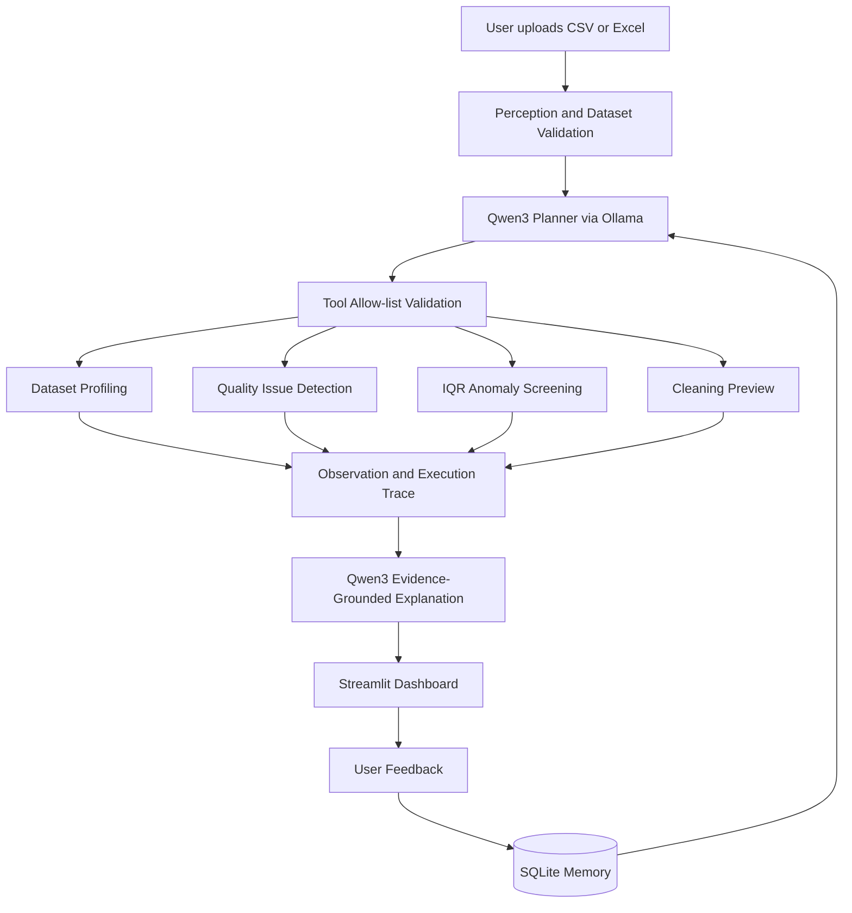

# DAT404 — AI-Powered Data Quality Detective

An intelligent, tool-using data quality agent powered by **Ollama and Qwen3**, with a Streamlit interface and SQLite memory.

| Component | Technology |
|---|---|
| Local LLM | Ollama – Qwen3 (`qwen3:8b`) |
| Programming Language | Python |
| User Interface | Streamlit |
| Data Processing | Pandas, NumPy |
| Visualisation | Matplotlib, Streamlit Charts |
| Memory Storage | SQLite |
| Supported Input | CSV, XLSX, XLS |

---

## 1. Project Overview

Poor-quality data can lead to inaccurate analysis and unreliable decisions. Missing values, duplicate records, inconsistent entries and unusual numerical values can affect the quality of data-driven outcomes.

The **AI-Powered Data Quality Detective** is an intelligent agent designed to help students, data analysts and small teams investigate the quality of tabular datasets.

The system combines a local Large Language Model (LLM) with deterministic Python tools to:

- Understand user investigation goals.
- Analyse uploaded CSV and Excel datasets.
- Identify missing values, duplicate rows and constant columns.
- Detect potential numerical outliers using the Interquartile Range (IQR) method.
- Generate non-destructive data-cleaning recommendations.
- Explain findings using evidence from Python tools.
- Store investigation episodes and user feedback in SQLite.
- Use previous feedback to guide future investigations.

The application is designed to support human decision-making rather than automatically modify original datasets.

## 2. Why This Is an Intelligent Agent

Unlike a basic chatbot that only responds to user questions, this system follows a goal-directed process involving planning, tool execution, observation, explanation and memory.

The agent operates through the following stages:

1. **Perceive:** Receives the uploaded dataset and the user's investigation goal.
2. **Plan:** Qwen3 generates a plan by selecting appropriate tools.
3. **Validate:** The agent checks proposed tool names against a restricted allow-list.
4. **Act:** Python tools perform actual dataset profiling, quality checks, anomaly screening and cleaning-preview generation.
5. **Observe:** The agent collects tool outputs, execution results and status information.
6. **Explain:** Qwen3 generates an explanation grounded in the collected tool evidence.
7. **Remember:** SQLite stores investigation episodes and user feedback.
8. **Adapt:** Previous feedback summaries help guide priorities in future investigations.

If Qwen3 is unavailable or generates an invalid plan, the system can use a predefined safe fallback plan to continue deterministic analysis where possible.

## 3. PEAS Description

The PEAS framework describes the agent's task environment.

| Element | Description |
|---|---|
| Performance Measure | Accurate issue detection, successful tool execution, evidence-grounded explanations, useful recommendations and low failure rate |
| Environment | Local computer, uploaded CSV and Excel datasets, Python runtime, Ollama service and Streamlit interface |
| Actuators | Python tool execution, investigation reports, visualisations, cleaning recommendations and feedback storage |
| Sensors | User goals, uploaded file contents, data types, missing values, duplicate records, numerical distributions and user feedback |

## 4. System Architecture

The system uses a hybrid architecture combining an LLM-based planner and deterministic Python tools.



### Main Architecture Components

- **User Interface:** Streamlit allows users to upload datasets, provide investigation goals and view results.
- **LLM Planner:** Qwen3 generates a tool-use plan based on the user's request.
- **Agent Controller:** Validates the plan, executes permitted tools and manages the investigation workflow.
- **Python Tools:** Perform deterministic data analysis.
- **Observation Layer:** Collects tool outputs and execution traces.
- **Explanation Layer:** Produces natural-language explanations grounded in actual analysis results.
- **Memory:** SQLite stores investigation episodes and user feedback to support future adaptation.

## 5. Python Tools

The agent uses four main deterministic Python tools.

| Tool | Functionality |
|---|---|
| `profile_dataset` | Reports dataset dimensions, column names, data types, numerical summaries and memory usage. |
| `detect_quality_issues` | Identifies missing values, duplicate rows, constant columns and blank text values. |
| `detect_anomalies` | Screens eligible numerical columns for potential outliers using the IQR method. |
| `create_cleaning_preview` | Generates non-destructive cleaning recommendations without overwriting the original dataset. |

### Outlier Detection

The system uses the Interquartile Range method.

\[
IQR = Q_3-Q_1
\]

\[
Lower\ Bound = Q_1-1.5(IQR)
\]

\[
Upper\ Bound = Q_3+1.5(IQR)
\]

Values outside these bounds are identified as potential outlier candidates.

These candidates are not automatically classified as errors because unusual values may be valid observations.

## 6. Memory and Feedback Mechanism

The project uses SQLite as its persistent memory mechanism.

It supports two main types of stored information:

**Investigation Episodes**

- Records investigation experiences.
- Supports retrieval of recent investigation history.

**User Feedback**

- Stores user ratings.
- Stores feedback comments.
- Records feedback categories such as missing values, duplicates, outliers and cleaning.

The agent generates feedback guidance summaries using stored feedback information. These summaries can help prioritise relevant concerns in subsequent explanations.

This mechanism provides a basic form of feedback-informed adaptation.

## 7. Project Structure

The recommended repository structure is:

```text
Agent/
│
├── agent.py
├── app.py
├── tools.py
├── memory.py
├── README.md
├── requirements.txt
│
├── evaluation/
│   └── test_cases.csv
│
├── outputs/
│
├── notebooks/
│   └── DAT404_Data_Quality_Detective.ipynb
│
└── docs/
    ├── architecture.png
    └── technical_report.pdf
```

The structure may be adjusted according to the final files included in the repository.

## 8. Installation and Setup

### Prerequisites

- Python 3.10 or newer.
- Ollama installed on the local computer.
- Qwen3 model (`qwen3:8b`).
- Git.
- VS Code or another Python development environment.

### Step 1: Clone the repository

```bash
git clone https://github.com/youarestillugly/Agent.git
cd Agent
```

### Step 2: Create a virtual environment

```bash
python -m venv .venv
```

Activate it on macOS or Linux:

```bash
source .venv/bin/activate
```

On Windows:

```bash
.venv\Scripts\activate
```

### Step 3: Install dependencies

```bash
pip install -r requirements.txt
```

### Step 4: Install and configure Ollama

Install Ollama from:

https://ollama.com/

Download the Qwen3 model:

```bash
ollama pull qwen3:8b
```

Start the Ollama application or service and ensure its local API is available at:

```text
http://localhost:11434
```

The application uses the configured model name and Ollama URL from its sidebar.

## 9. Running the Application

From the project directory, execute:

```bash
streamlit run app.py
```

Open the local URL displayed in the terminal, usually:

```text
http://localhost:8501
```

### Application Workflow

1. Open the Streamlit application.
2. Upload a CSV or Excel dataset.
3. Select the required worksheet if an Excel workbook is uploaded.
4. Preview the dataset.
5. Enter an investigation goal.
6. Click **Run Intelligent Investigation**.
7. Review the agent explanation and execution trace.
8. Examine data quality findings and potential outliers.
9. Review non-destructive cleaning recommendations.
10. Ask follow-up questions.
11. Submit feedback through the feedback interface.

## 10. Evaluation Methodology

The project uses test scenarios to assess the functionality, reliability and safety of the agent.

The evaluation includes normal cases, edge cases and failure scenarios.

### Evaluation Test Cases

| Test ID | Scenario | Expected Behaviour |
|---|---|---|
| TC01 | Standard dataset | Successfully profile and investigate the dataset. |
| TC02 | Excel workbook with multiple sheets | Allow sheet selection and investigate the selected sheet. |
| TC03 | Missing values | Correctly identify missing values and their counts. |
| TC04 | Duplicate records | Identify duplicates and generate a cleaning preview without modifying the source. |
| TC05 | Numerical outliers | Identify potential outliers using IQR. |
| TC06 | Dataset without numerical columns | Complete profiling without crashing. |
| TC07 | Very small dataset | Avoid unsuitable anomaly detection. |
| TC08 | Ollama unavailable | Provide a clear fallback or error while retaining deterministic findings where possible. |
| TC09 | Invalid LLM plan | Reject invalid tool selections and use a safe fallback plan. |
| TC10 | User feedback | Store feedback in SQLite and generate feedback guidance. |

The evaluation scenarios and supporting data are maintained in the `evaluation/` directory.

### Evaluation Metrics

The following metrics can be used to evaluate system performance.

**1. Tool Execution Success Rate**

\[
\frac{\text{Successful Tool Calls}}{\text{Total Attempted Tool Calls}}\times100
\]

**2. Task Completion Rate**

\[
\frac{\text{Successfully Completed Test Cases}}{\text{Total Test Cases}}\times100
\]

**3. Tool Selection Accuracy**

\[
\frac{\text{Relevant Selected Tools}}{\text{Expected Relevant Tools}}\times100
\]

**4. Mean Execution Latency**

\[
\frac{\text{Total Execution Time}}{\text{Completed Investigations}}
\]

**5. User Feedback Rating**

The average rating is calculated using the submitted user ratings on a scale of 1 to 5.

Actual experimental results should be recorded and reported. No performance values should be assumed or invented.

## 11. Safety and Guardrails

Several safety mechanisms are included in the project.

- **Restricted Tool Access:** The agent can only execute tools included in its predefined allow-list.
- **Plan Validation:** Invalid or malformed LLM plans are rejected.
- **Fallback Planning:** A predefined plan is used when the LLM cannot generate a valid plan.
- **Non-destructive Cleaning:** Cleaning recommendations do not overwrite the original dataset.
- **Evidence-Grounded Explanations:** Numerical findings are obtained from Python tools rather than relying solely on LLM-generated statements.
- **Outlier Caution:** Outliers are treated as candidates for review, not confirmed data errors.
- **Local Processing:** The application uses a local Ollama service for LLM interaction.

Users should avoid uploading sensitive personal information unless they have the appropriate authorisation.

## 12. Limitations

The current prototype has several limitations:

1. **Local Hardware Requirements:** Running Qwen3 locally requires sufficient memory and computational resources.
2. **LLM Reliability:** Qwen3 may generate inaccurate or incomplete natural-language explanations.
3. **Basic Outlier Detection:** The IQR method may not be suitable for every data distribution.
4. **Limited Validation Rules:** The system focuses on general tabular data quality rather than specialised domain-specific validation.
5. **Feedback Adaptation:** Feedback summaries influence investigation priorities but do not retrain or fine-tune the LLM.
6. **Supported File Formats:** The current application focuses on CSV and Excel files.
7. **Human Review:** Cleaning recommendations require human verification before any changes are applied.

## 13. Future Work

Possible improvements include:

- Adding domain-specific data validation rules.
- Supporting more file formats and larger datasets.
- Introducing additional anomaly detection algorithms.
- Improving memory retrieval and feedback-based adaptation.
- Adding more detailed investigation history.
- Improving evaluation with manually labelled datasets.
- Comparing LLM-assisted planning against predefined planning.
- Adding more comprehensive explainability and reporting features.

## 14. Demonstration Plan

The following scenarios can be used during the project demonstration.

**Scenario 1: Normal Investigation**

Upload a dataset containing missing values and duplicate records. Demonstrate profiling and quality issue detection.

**Scenario 2: Multi-step Agent Investigation**

Ask the agent to perform a complete data quality investigation. Demonstrate Qwen3 planning, tool execution, execution traces, findings and recommendations.

**Scenario 3: Edge Case Investigation**

Upload a dataset with no numerical columns or a very small dataset. Demonstrate how the agent handles situations where certain analyses are unsuitable.

**Scenario 4: Feedback and Memory**

Submit a feedback rating and comment. Demonstrate that the feedback is stored in SQLite and contributes to future feedback guidance.

**Scenario 5: Safe Fallback**

Demonstrate how the agent handles an unavailable Ollama service or an invalid LLM-generated plan.

## 15. Academic Integrity and Development Evidence

This project is developed as part of the DAT404 coursework.

All project components should be understood, tested and documented by the project developer.

Development evidence should include:

- Source-code repository.
- Dated Git commits.
- Evaluation test cases and actual results.
- Screenshots of the working application.
- Technical report and architecture documentation.
- References and attribution for external tools, libraries, models and datasets.

## 16. References and Attribution

The project uses the following technologies and resources:

- **Ollama:** Local LLM runtime. https://ollama.com/
- **Qwen:** Qwen3 language model. https://qwenlm.github.io/
- **Python:** Programming language. https://www.python.org/
- **Pandas:** Data analysis and manipulation. https://pandas.pydata.org/
- **NumPy:** Numerical computing. https://numpy.org/
- **Streamlit:** Interactive application framework. https://streamlit.io/
- **Matplotlib:** Data visualisation. https://matplotlib.org/
- **SQLite:** Database engine. https://www.sqlite.org/

Additional datasets, research papers and external resources used during development should be acknowledged separately.

---

**Project:** DAT404 — AI-Powered Data Quality Detective  
**LLM:** Qwen3 (`qwen3:8b`)  
**Runtime:** Ollama  
**Interface:** Streamlit  
**Memory:** SQLite  
**Input Formats:** CSV, XLSX, XLS